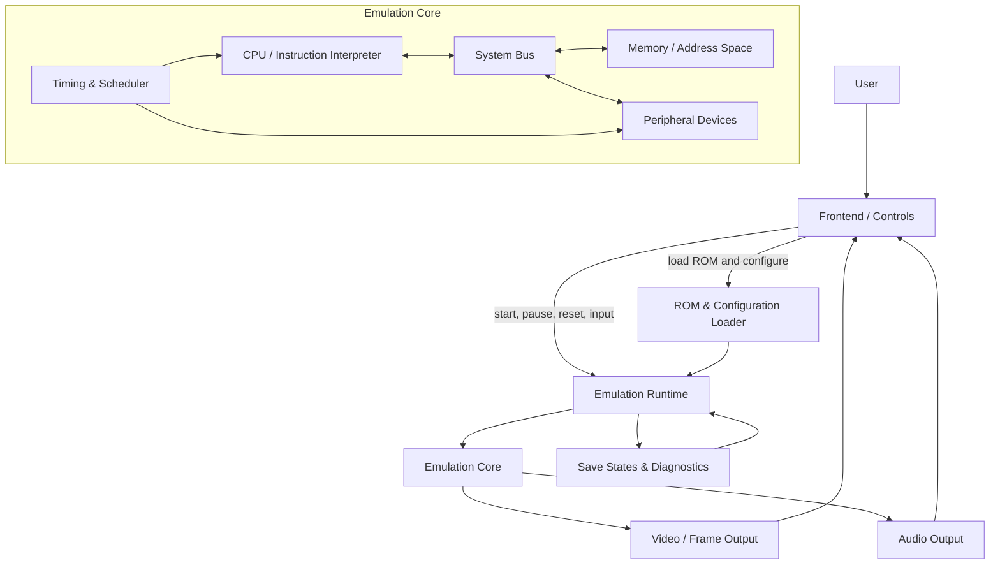

# Architecture Overview

> **Status:** This is a conceptual architecture for Emulador-2.0, not a description of implemented modules. The repository currently contains only a README, so the components below are a proposed starting point.

## Component responsibilities

- **Frontend / Controls:** Presents the user interface and forwards control and input events.
- **ROM & Configuration Loader:** Validates and prepares program images and emulator settings.
- **Emulation Runtime:** Coordinates lifecycle operations such as starting, pausing, resetting, and stepping execution.
- **Emulation Core:** Implements CPU execution, memory and bus behavior, peripheral devices, and timing.
- **Video / Audio Output:** Converts emulated device output into frames and audio for the frontend.
- **Save States & Diagnostics:** Provides a conceptual place for state snapshots and runtime inspection.
